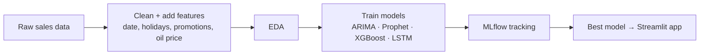

<p align="center">
  
</p>

<p align="center">
  
</p>

<p align="center">
  
  
  
  
  
</p>

## What is this?

A supermarket chain needs to know **how much it will sell** to order the right amount of stock.

We used the data of **Corporación Favorita**, a big grocery chain in Ecuador, from the [Kaggle Store Sales competition](https://www.kaggle.com/c/store-sales-time-series-forecasting). We trained several models to predict **daily sales** for each store and product family.

## How it works



## Models we tried

| Model | Notebook |
|-------|----------|
| ARIMA + Prophet | `models/Arima&prophet_model.ipynb` |
| XGBoost ✅ used in the app | `models/XGboost_model.ipynb` |
| LSTM | `models/lstm-model (1).ipynb` |
| K-Means (store clusters) | `models/K-MeansModel.ipynb` |

## The app

The Streamlit app has 5 pages:

| Page | What you can do |
|------|-----------------|
| 🏠 **Home** | Project overview |
| 🔎 **Data Filtering** | Search and filter the data |
| 📊 **Data Analysis** | Interactive charts: sales by month, day, promotions and transactions |
| 🔮 **Data Prediction** | Pick a store, date and cluster and get the predicted sales from XGBoost |
| 🧪 **MLflow** | Train the model again and log the run in MLflow |

## How to run

```bash
pip install -r requirements.txt
streamlit run main.py
```

To see the MLflow runs:

```bash
mlflow ui
```

Then open http://localhost:5000

## Files

```
├── main.py              # app menu
├── Home.py              # home page
├── Filtering.py         # data filtering page
├── Analysis.py          # charts page
├── Prediction.py        # prediction page (XGBoost)
├── ML_Flow.py           # MLflow training page
├── models/              # notebooks for each model
├── new_model (1).pkl    # trained XGBoost model
└── subset_data.csv      # sample data for the app
```

## Team

Built as a team project at the **Digital Egypt Pioneers Initiative (DEPI)**:

- [Emad Mostafa](https://github.com/3madMostafa)
- [Abdelrahman Zahran](https://github.com/AbdoZahran)
- [Omar Sahwan](https://github.com/OmarSahwan)
- [heka2002](https://github.com/heka2002)

<p align="center">
  
</p>
